# Hub

Aplicação web para organizar tarefas pessoais em um calendário, acompanhar prazos e personalizar a forma de visualizar cada período.

> **Status:** tarefas locais, calendário, biblioteca de leitura, downloads de vídeos e integração Google Tasks estão disponíveis. Google Tasks requer credenciais OAuth e uma chave de instalação fora do Git.

## Visão geral

O Hub combina uma interface Vue com uma API Spring Boot. As tasks locais são salvas no banco H2 e podem ser criadas sem conexão com serviços externos.

### Calendário

Alterne entre as visualizações diária, semanal, mensal e anual. Cada uma oferece apresentações próprias, e as configurações permitem escolher qual apresentação abrir por padrão. Clique em uma data ou horário para iniciar uma task com esses dados preenchidos.

Capturas atuais da aplicação no navegador (30/10/2026):

| Dia | Semana |
| --- | --- |
| [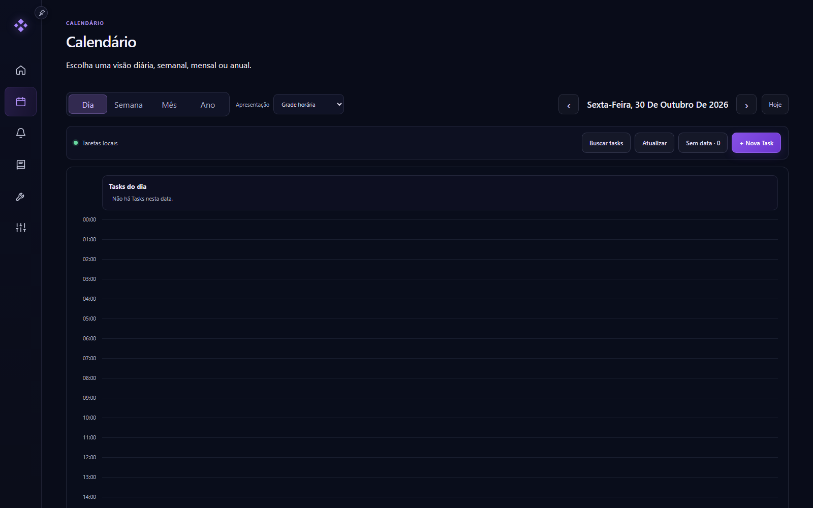](docs/screenshots/calendar-day.png) | [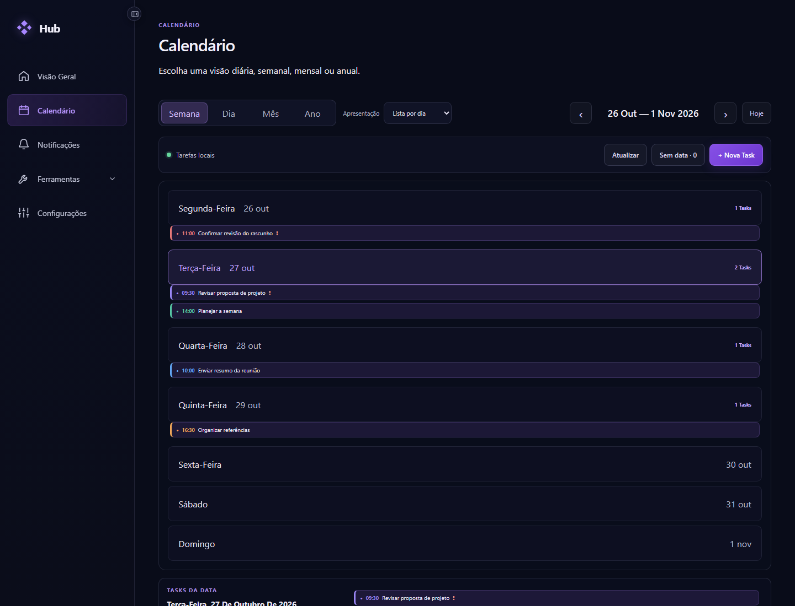](docs/screenshots/calendar-week.png) |

| Mês | Ano |
| --- | --- |
| [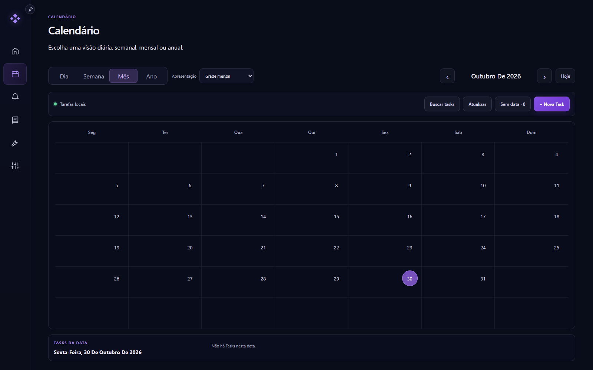](docs/screenshots/calendar-month.png) | [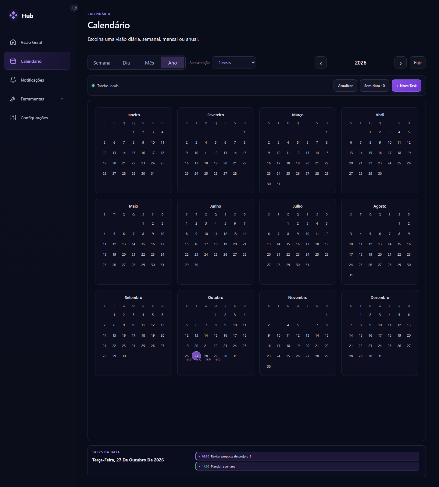](docs/screenshots/calendar-year.png) |

Mockups de referência (não são capturas do app):

| Dia | Semana |
| --- | --- |
| 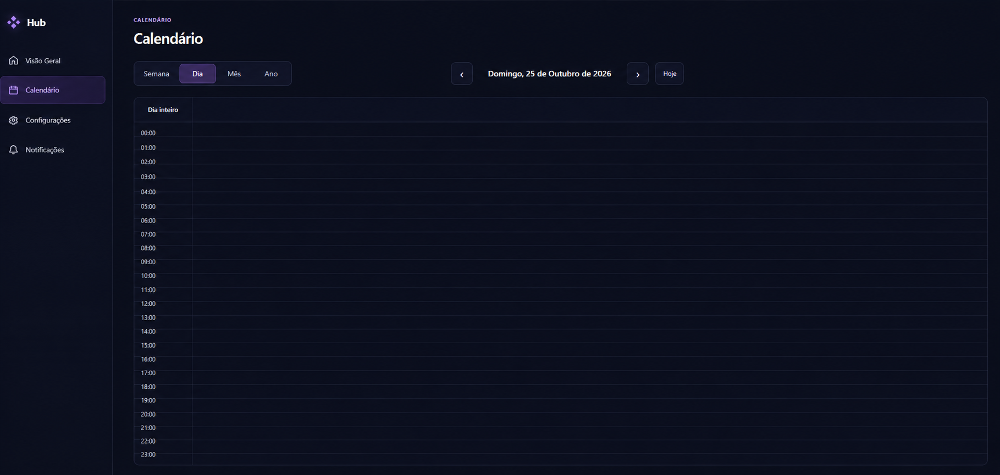 | 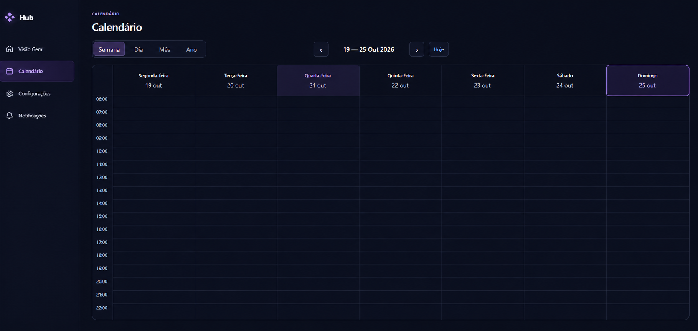 |

| Mês | Ano |
| --- | --- |
| 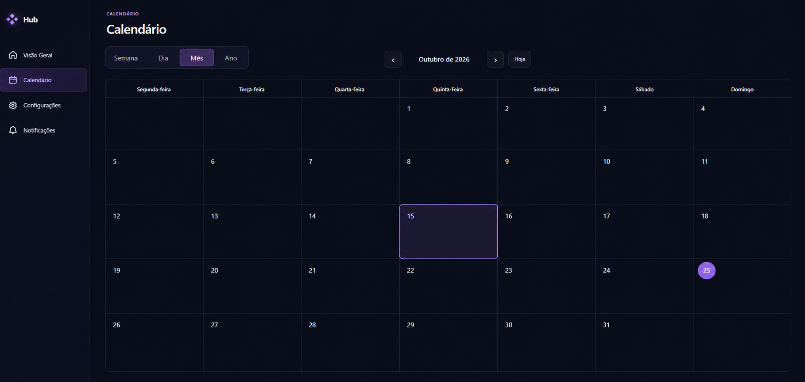 | 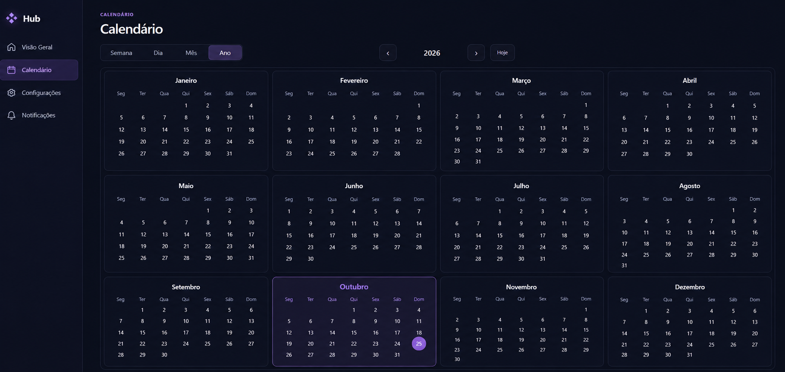 |

### Outras telas

Capturas atuais da aplicação no navegador (30/10/2026):

| Visão Geral | Notificações |
| --- | --- |
| [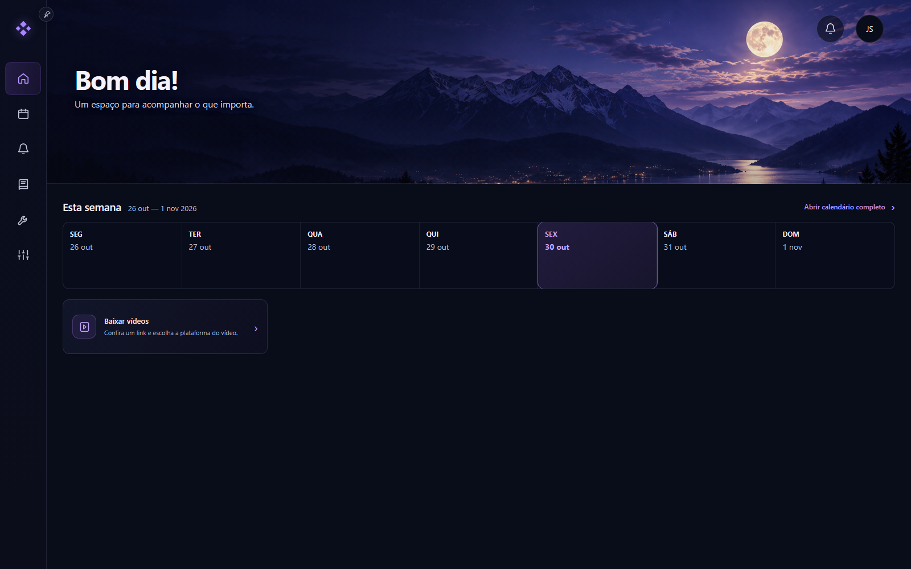](docs/screenshots/overview.png) | [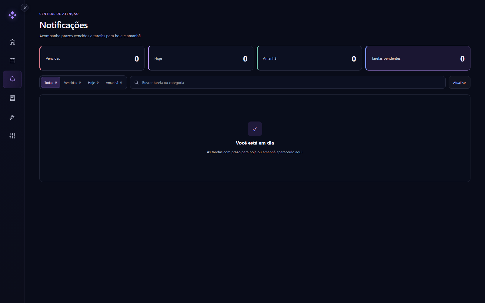](docs/screenshots/notifications.png) |

| Configurações | Ferramentas |
| --- | --- |
| [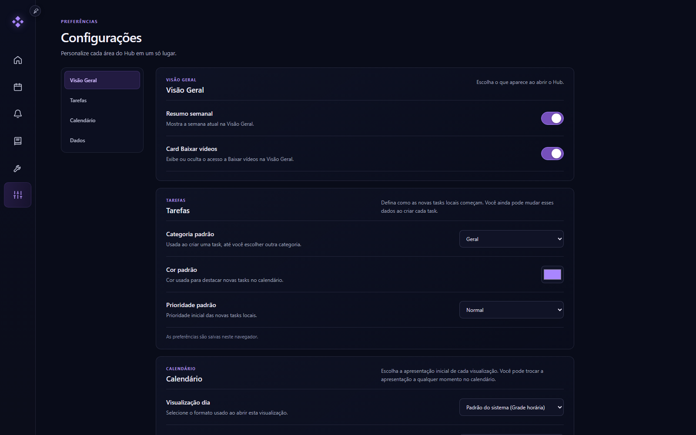](docs/screenshots/settings.png) | [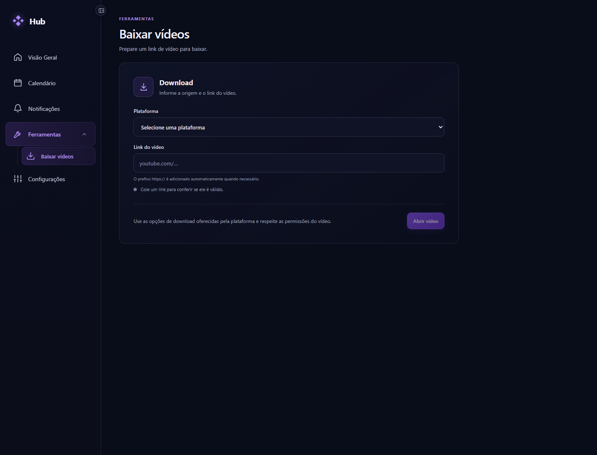](docs/screenshots/tools.png) |

| Biblioteca de leitura |
| --- |
| [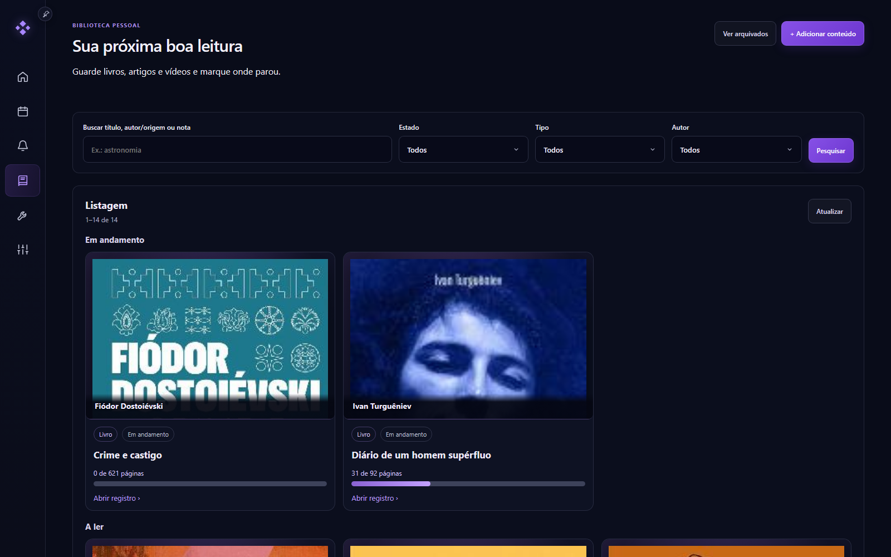](docs/screenshots/reading-library.png) |

### Recursos

- **Tasks locais:** título, data, horário, categoria, cor, prioridade, observações e estado de conclusão.
- **Busca global:** no Calendário, encontre tasks por título, categoria ou observações e filtre por estado, prioridade e período, incluindo tasks sem data ou concluídas.
- **Biblioteca de leitura:** organize livros, artigos e vídeos em fileiras por estado, na ordem **Em andamento**, **A ler** e **Concluído**. Cada fileira aparece somente quando há resultados. A busca aceita título, autor/origem e notas, com filtros por estado, tipo e autor e paginação no servidor. Livros podem ter capa local, etiquetas, notas e progresso por páginas; capas entram na cópia portátil.
- **Notificações:** visão de tasks vencidas, para hoje e para amanhã.
- **Google Tasks:** cada conta Hub pode conectar sua própria conta Google, escolher listas, sincronizar e editar tarefas e configurar avisos. O conteúdo de outra conta não fica disponível para administradores.
- **Configurações:** resumo semanal, valores padrão para novas tasks e apresentação padrão de cada visualização do calendário.
- **Baixar vídeos:** prepare um vídeo público individual do YouTube ou Instagram e receba o arquivo pelo gerenciador de downloads do navegador. Escolha 480p, 720p ou 1080p como qualidade preferida; quando só houver uma resolução maior, o Hub avisa e entrega uma versão original disponível, sem converter. O acesso depende da permissão de baixar vídeos.
- **Layout adaptável:** navegação lateral que pode ser recolhida e interface ajustada para telas menores.

### Contas e permissões

Na primeira abertura, a instalação apresenta um assistente local para criar a conta Administrador. O assistente encerra após a criação e atribui a essa conta os registros e capas que já existiam. Não há usuário nem senha padrão. Depois, o Administrador cria contas e perfis nomeados com permissões para tarefas, biblioteca, configurações e ferramentas. Os registros pessoais e as cópias portáteis pertencem à conta autenticada.

O login usa sessão do servidor, cookie HttpOnly, proteção CSRF e limite de tentativas. O Compose publica a interface e a API somente em `127.0.0.1`; o backend executado fora do Docker também usa bind local. **O primeiro setup sem token só está aprovado para esse acesso local. Não publique o app em LAN ou na internet**; uma implantação remota precisa desativar o setup aberto e definir um mecanismo administrativo de bootstrap seguro antes de expor a aplicação.

Os dados legados sem proprietário são associados ao primeiro Administrador. A conexão Google antiga `primary` permanece nessa conta. Cada nova conta Hub mantém seu próprio estado e credenciais do Google Tasks.

## Tecnologias

| Camada | Tecnologias |
| --- | --- |
| Frontend | Vue 3, Vue Router, Vite 8 |
| Backend | Java 25, Spring Boot 4, Spring Data JPA |
| Dados | H2 em arquivo |
| Containers | Docker Compose, Nginx |

## Requisitos

- Node.js 22.12 ou superior
- Java 25
- Para downloads fora do Docker: Python 3.11+, `yt-dlp[default]==2026.10.26`, FFmpeg/ffprobe e Node.js 22 ou superior no `PATH`
- Docker Desktop ou Docker Engine com Docker Compose v2, para executar em containers

O repositório inclui Maven Wrapper, então não é necessário instalar Maven separadamente.

## Executar localmente

Abra dois terminais na raiz do projeto.

**Backend** — Windows:

```powershell
cd back
.\mvnw.cmd spring-boot:run
```

Linux ou macOS:

```sh
cd back
./mvnw spring-boot:run
```

**Frontend**:

```sh
cd front
npm ci
npm run dev
```

Abra <http://localhost:8081>. O Vite encaminha as chamadas `/api` para o backend em `127.0.0.1:8080`.

O Docker instala as dependências de download, incluindo yt-dlp 2026.10.26, EJS compatível, Node 22.23.4 e FFmpeg/ffprobe. Fora do Docker, instale essas ferramentas ou configure seus caminhos. A ausência de uma delas deixa apenas o downloader indisponível. Consulte [configuração, API e limites do downloader](docs/video-downloads.md).

Para habilitar Google Tasks no Windows, configure `HUB_GOOGLE_OAUTH_CLIENT_ID`, `HUB_GOOGLE_CLIENT_SECRET_FILE` e `HUB_GOOGLE_CREDENTIAL_KEY_FILE` no ambiente do backend. O arquivo do segredo OAuth deve ser texto; a chave deve conter exatamente 32 bytes. Mantenha ambos fora do repositório. Registre no Google Cloud o URI de redirecionamento exato `http://localhost:8081/api/google-tasks/oauth/callback`.

## Executar com Docker Compose

Na raiz do projeto:

```sh
docker compose up --build -d
```

Abra <http://localhost:8081>. O front é compilado e servido pelo Nginx, que encaminha `/api` ao back. A API também é publicada em <http://localhost:8080>. Os containers possuem healthchecks, e o front aguarda a API ficar pronta.

Para personalizar as portas, copie `.env.example` para `.env` e altere `FRONTEND_PORT` ou `BACKEND_PORT`. Por padrão, as portas são publicadas somente em `127.0.0.1`.

Para habilitar Google Tasks no Compose, configure `HUB_GOOGLE_OAUTH_CLIENT_ID` e os caminhos locais de `HUB_GOOGLE_CLIENT_SECRET_FILE` e `HUB_GOOGLE_CREDENTIAL_KEY_FILE` no `.env`. Crie os dois arquivos fora do Git; a chave deve conter exatamente 32 bytes. Suba a aplicação com o overlay de secrets, montados somente para leitura:

```sh
docker compose -f compose.yaml -f compose.google.yaml up --build -d
```

Registre no Google Cloud o URI de redirecionamento exato `http://localhost:8081/api/google-tasks/oauth/callback`. Sem os três segredos válidos, a integração permanece desabilitada.

```sh
docker compose ps
docker compose logs -f
docker compose down
```

`docker compose down` mantém o volume `hub_storage`. O comando `docker compose down --volumes` apaga o banco e as imagens armazenadas.

## Dados e privacidade

- Sem Docker, os dados ficam sob `%LOCALAPPDATA%\Hub`: H2 em `database\hub` e capas em `users\<ownerId>\reading-library\covers`.
- Com Docker, o volume nomeado `hub_storage` monta em `/data`, com H2 em `/data/database/hub` e arquivos de cada usuário em `/data/users/<ownerId>`.
- Preferências de interface são armazenadas por usuário na API. Valores antigos em `localStorage` namespaced por conta servem para a migração inicial e só são removidos depois da confirmação do servidor, sem alterações pendentes.
- Vídeos preparados são temporários e isolados por conta. Não entram no banco, na cópia portátil ou no volume de capas; expiram após dez minutos sem iniciar a transferência e não são recuperados após reiniciar o backend.
- A API local usa `127.0.0.1` por padrão; no Compose, as portas também são vinculadas apenas a `127.0.0.1`.
- A chave OAuth é única para a instalação e deve ser preservada junto do H2. Em Compose, use o overlay opcional de secrets; no Windows, guarde o arquivo da chave fora do repositório.

Para migrar os volumes legados, use o procedimento offline em [docs/hub-storage-migration.md](docs/hub-storage-migration.md). Ele exige backend parado e backup byte a byte verificado, escreve apenas em um destino novo e não executa cutover. Mantenha `hub_data` e `hub_media` intactos até validar o novo armazenamento e completar a janela de rollback. OAuth client secret e chave de credenciais continuam externos e não são copiados pela migração. Se transferir um banco Windows com credencial Google antiga para Compose, configure primeiro a chave de instalação e o client secret no Windows, abra Google Tasks e faça uma sincronização para recriptografar o token legado com a chave nova. Sem a chave DPAPI antiga, será necessário reconectar a conta Google. A cópia portátil exportada pelo Hub inclui capas em um pacote ZIP de até 100 MiB; arquivos JSON antigos continuam importáveis, mas não contêm imagens.

## Importar e exportar cópias portáteis

Na tela **Configurações → Dados**, exporte uma cópia ZIP ou escolha um arquivo para revisar a prévia e confirmar a importação. O perfil precisa da permissão `PORTABLE_COPY`; ela não é concedida ao perfil padrão **Usuário**. Essa permissão libera a cópia dos dados da própria conta, independentemente das permissões de leitura dos módulos.

A exportação atual grava ZIP **v12**. O arquivo contém dados lógicos da conta, não é uma cópia física do H2 nem uma migração de contas. O servidor associa os registros importados à conta autenticada; o ZIP não deve conter `ownerId`, contas, perfis ou credenciais.

### Estrutura do ZIP v12

O pacote contém o manifesto, oito arquivos de dados e zero ou mais capas:

```text
hub-portable-copy.zip
├── manifest.json
├── data/
│   ├── tasks.json
│   ├── series.json
│   ├── readingItems.json
│   ├── authors.json
│   ├── habits.json
│   ├── focusSessions.json
│   ├── notes.json
│   └── preferences.json
└── assets/
    └── <reading-item-uuid>.jpg|png
```

As oito seções de `data/` são obrigatórias, mesmo quando não há registros; nesse caso, use `[]`. `preferences.json` é sempre um objeto. Não adicione pastas ZIP, caminhos extras ou entradas duplicadas.

`manifest.json` tem este formato. O exemplo é esquemático: cada tamanho e hash precisa corresponder aos bytes exatos do arquivo indicado.

```json
{
  "formatVersion": 12,
  "generatedAt": "2026-10-31T12:00:00Z",
  "sections": [
    {
      "name": "tasks",
      "path": "data/tasks.json",
      "count": 1,
      "size": 123,
      "sha256": "<sha256 dos bytes de data/tasks.json>"
    }
  ],
  "assets": [
    {
      "path": "assets/01234567-89ab-4cde-8012-3456789abcde.png",
      "size": 456,
      "sha256": "<sha256 dos bytes da imagem>"
    }
  ]
}
```

No manifesto real, `sections` contém exatamente estas oito seções: `tasks`, `series`, `readingItems`, `authors`, `habits`, `focusSessions`, `notes` e `preferences`. Cada entrada registra o nome, caminho exato, contagem, tamanho em bytes e SHA-256 em hexadecimal minúsculo. Para arquivos de lista, `count` é o número de elementos; para o objeto de preferências, é `1`. A lista `assets` descreve cada imagem pelo caminho, tamanho e hash.

### Conteúdo de cada arquivo

Todos os arquivos de lista são arrays JSON. Datas usam `YYYY-MM-DD`, horários usam `HH:mm:ss` e timestamps usam ISO-8601 UTC. Identificadores são preservados e reutilizáveis entre contas; os campos abaixo não incluem identidade do proprietário.

Valores enumerados aceitos: tarefa tem `type: "LOCAL"` e `priority` `LOW`, `NORMAL` ou `HIGH`; leitura tem `type` `BOOK`, `ARTICLE` ou `VIDEO` e `status` `TO_READ`, `IN_PROGRESS` ou `COMPLETED`; sessão de foco tem `state` `ACTIVE`, `PAUSED` ou `ENDED`, com `endReason` `NORMAL`, `EARLY` ou `ADJUSTED` quando encerrada. `weekdaysMask` é uma máscara de 1 a 127 para os dias previstos do hábito. O checklist aceita até 20 itens por tarefa.

| Arquivo | Campos por registro |
| --- | --- |
| `data/tasks.json` | `id`, `title`, `dueDate`, `dueTime`, `completed`, `type`, `category`, `color`, `priority`, `notes`, `seriesId`, `seriesPosition`, `checklist`. A cópia inclui somente tarefas locais (`type: "LOCAL"`). `seriesId` e `seriesPosition` são nulos em tarefas avulsas. `checklist` é um array de `{ "id", "text", "checked", "position" }`, com posições começando em zero. |
| `data/series.json` | `id`, `title`, `startDate`, `dueTime`, `occurrenceCount`, `timeZoneId`, `ended`. Ocorrências apontam para uma série por `seriesId` e indicam sua posição. |
| `data/readingItems.json` | `id`, `title`, `type`, `authorOrSource`, `url`, `status`, `progressMarker`, `totalPages`, `currentPage`, `note`, `tags`, `archived`, `createdAt`, `updatedAt`, `coverSha256`, `coverFormat`, `coverSize`, `coverSourceUrl`, `authorIds`. `tags` é uma lista de strings; `authorIds` aponta para registros de `authors.json`. Campos de capa ficam ausentes/nulos quando o item não tem capa. |
| `data/authors.json` | `id`, `name`. Os IDs são referenciados por `authorIds` nos livros. |
| `data/habits.json` | `id`, `name`, `startDate`, `createdAt`, `updatedAt`, `schedules`, `pauses`, `checkIns`. Cada agenda tem `{ "effectiveFrom", "weekdaysMask" }`; cada pausa tem `{ "pausedOn", "resumedOn" }`; `checkIns` é uma lista de datas. Um hábito precisa ter ao menos uma agenda válida. |
| `data/focusSessions.json` | `id`, `objective`, `plannedSeconds`, `focusedSeconds`, `state`, `startedAt`, `resumedAt`, `pausedAt`, `endedAt`, `endReason`, `taskId`. Uma sessão ainda ativa é representada como pausada no arquivo; a sessão original não é alterada. |
| `data/notes.json` | `id`, `title`, `body`, `tags`, `pinned`, `archived`, `relatedTaskId`, `relatedTaskUnavailable`, `createdAt`, `updatedAt`. `relatedTaskId` pode ser nulo quando não há vínculo com tarefa. |
| `data/preferences.json` | Objeto com `weeklySummaryVisible`, `videoDownloaderCardVisible`, `sidebarPinned`, `taskDefaults` (`category`, `color`, `priority`) e `calendarPresentations` (`day`, `week`, `month`, `year`). Só essas preferências pessoais permitidas são copiadas. |

Exemplos mínimos do conteúdo de cada arquivo (IDs e datas são ilustrativos):

`data/tasks.json`:

```json
[
  {
    "id": "01234567-89ab-4cde-8012-3456789abcde",
    "title": "Revisar documento",
    "dueDate": "2026-11-02",
    "dueTime": null,
    "completed": false,
    "type": "LOCAL",
    "category": "Trabalho",
    "color": "#A986FF",
    "priority": "NORMAL",
    "notes": "",
    "seriesId": null,
    "seriesPosition": null,
    "checklist": [
      { "id": "11234567-89ab-4cde-8012-3456789abcde", "text": "Conferir referências", "checked": false, "position": 0 }
    ]
  }
]
```

`data/series.json`:

```json
[{ "id": "21234567-89ab-4cde-8012-3456789abcde", "title": "Revisão semanal", "startDate": "2026-11-02", "dueTime": "09:00:00", "occurrenceCount": 4, "timeZoneId": "America/Sao_Paulo", "ended": false }]
```

`data/readingItems.json`:

```json
[{ "id": "31234567-89ab-4cde-8012-3456789abcde", "title": "Guia de arquitetura", "type": "ARTICLE", "authorOrSource": "Equipe", "url": "https://example.com/guia", "status": "IN_PROGRESS", "progressMarker": "Capítulo 2", "totalPages": null, "currentPage": null, "note": "", "tags": ["trabalho"], "archived": false, "createdAt": "2026-10-31T12:00:00Z", "updatedAt": "2026-10-31T12:00:00Z", "authorIds": [] }]
```

`data/authors.json`:

```json
[{ "id": "41234567-89ab-4cde-8012-3456789abcde", "name": "Nome do autor" }]
```

`data/habits.json`:

```json
[{ "id": "51234567-89ab-4cde-8012-3456789abcde", "name": "Caminhar", "startDate": "2026-10-31", "createdAt": "2026-10-31T12:00:00Z", "updatedAt": "2026-10-31T12:00:00Z", "schedules": [{ "effectiveFrom": "2026-10-31", "weekdaysMask": 127 }], "pauses": [], "checkIns": ["2026-10-31"] }]
```

`data/focusSessions.json`:

```json
[{ "id": "61234567-89ab-4cde-8012-3456789abcde", "objective": "Revisar documento", "plannedSeconds": 1500, "focusedSeconds": 900, "state": "ENDED", "startedAt": "2026-10-31T11:00:00Z", "resumedAt": null, "pausedAt": null, "endedAt": "2026-10-31T11:15:00Z", "endReason": "NORMAL", "taskId": null }]
```

`data/notes.json`:

```json
[{ "id": "71234567-89ab-4cde-8012-3456789abcde", "title": "Ideia", "body": "Texto da nota", "tags": ["projeto"], "pinned": false, "archived": false, "relatedTaskId": null, "relatedTaskUnavailable": false, "createdAt": "2026-10-31T12:00:00Z", "updatedAt": "2026-10-31T12:00:00Z" }]
```

`data/preferences.json`:

```json
{
  "weeklySummaryVisible": true,
  "videoDownloaderCardVisible": true,
  "sidebarPinned": false,
  "taskDefaults": { "category": "Geral", "color": "#A986FF", "priority": "NORMAL" },
  "calendarPresentations": { "day": "", "week": "", "month": "", "year": "" }
}
```

### Capas e integridade

Cada capa é armazenada uma vez em `assets/<reading-item-uuid>.jpg` ou `.png`. O nome usa o mesmo ID do item em `readingItems.json`. O registro de leitura declara `coverFormat`, `coverSize` e `coverSha256`; o manifesto também declara caminho, tamanho e hash dos mesmos bytes. O arquivo precisa corresponder aos dois registros e ser uma imagem válida. O ZIP inclui a imagem original; a miniatura é recriada pelo Hub durante a importação.

Exemplo do vínculo. Os marcadores de hash e tamanho precisam ser substituídos pelos valores calculados da imagem. Estes são fragmentos, não arquivos completos.

Fragmento do item em `data/readingItems.json`:

```json
{
  "id": "31234567-89ab-4cde-8012-3456789abcde",
  "coverFormat": "png",
  "coverSize": 456,
  "coverSha256": "<sha256 da imagem>"
}
```

Entrada correspondente em `manifest.json`, dentro de `assets`:

```json
{
  "path": "assets/31234567-89ab-4cde-8012-3456789abcde.png",
  "size": 456,
  "sha256": "<o mesmo sha256 da imagem>"
}
```

O importador verifica nomes e caminhos permitidos, campos inesperados ou repetidos, contagens, tamanhos, hashes, referências de capas e seções obrigatórias antes de gravar. Todo arquivo de imagem deve estar declarado no manifesto e vinculado por um item de leitura; imagens sem referência também são rejeitadas. ZIP v12 inválido, truncado, com caminho inesperado, entrada duplicada ou conteúdo expandido acima do limite é rejeitado por inteiro. Limites atuais: ZIP de até 100 MiB, conteúdo expandido de até 100 MiB, manifesto de até 90 MiB e imagem de até 8 MiB. O exportador falha por inteiro se qualquer limite for ultrapassado; não produz cópia parcial.

### Importação, conflitos e dados excluídos

A prévia informa novos registros, itens idênticos, conflitos e preferências que seriam substituídas. Registros idênticos são ignorados; um conflito de conteúdo para o mesmo ID impede a gravação do pacote inteiro. Preferências diferentes só são substituídas após confirmação, e uma alteração concorrente exige nova prévia. ZIPs antigos sem preferências preservam as preferências da conta.

O pacote **não inclui** Google Tasks — tokens, estado de conexão, listas, avisos ou sincronização —, credenciais, sessões de login, contas/perfis Hub, configurações globais nem trabalhos temporários de download. O exportador escreve v12; o importador também aceita JSON v1–v4 e ZIP v5–v11 para compatibilidade.

## Estrutura do projeto

```text
.
├── back/                 # API Spring Boot, persistência e Dockerfile
├── front/                # Aplicação Vue, Vite, Nginx e Dockerfile
├── compose.yaml          # Orquestração do frontend e backend
└── .env.example          # Portas e configuração opcional
```
