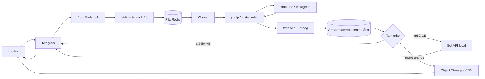
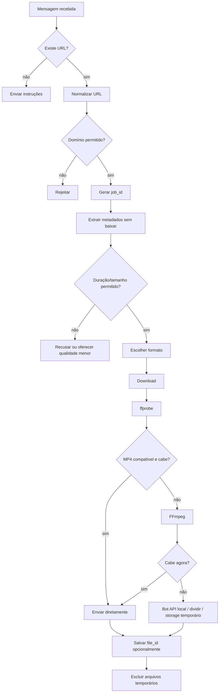
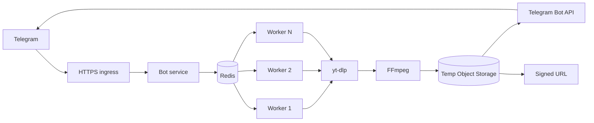

# Como bots do Telegram baixam vídeos do YouTube e Instagram a partir de links

## Resumo executivo

**Conclusão principal:** na maior parte dos bots desse tipo, **não existe uma API oficial do YouTube ou do Instagram que receba qualquer URL e devolva o arquivo de vídeo**. O funcionamento normalmente é uma combinação de:

1. o bot recebe a URL pelo Telegram;
2. uma ferramenta local — tipicamente **yt-dlp**, Instaloader ou um serviço como Cobalt — identifica a plataforma e extrai os metadados e os URLs reais dos fluxos de mídia;
3. o servidor baixa áudio/vídeo diretamente da origem;
4. **FFmpeg** combina, remuxa ou transcodifica o conteúdo;
5. o arquivo resultante é enviado de volta pelo Telegram ou colocado temporariamente em object storage/CDN. citeturn23search2turn19search2turn21search1

Portanto, para a pergunta original — **“é alguma API ou lógica local?”** — a resposta é: **geralmente é lógica local**. Uma API externa é opcional. Em Python, por exemplo, `yt-dlp` pode ser importado como biblioteca; em Node.js, é muito comum executar o binário `yt-dlp` como subprocesso. Há também projetos como **Cobalt**, que encapsulam essa mesma classe de problema atrás de uma API HTTP autohospedada. citeturn23search2turn19search3

O ponto mais importante é distinguir três coisas:

| Abordagem | O que faz | Serve para “qualquer link”? | Minha avaliação |
|---|---|---:|---|
| YouTube Data API / Instagram API oficiais | Metadados, publicação e recursos autorizados | **Não** | Útil complementarmente |
| `yt-dlp` / Instaloader / gallery-dl | Extração local, não oficial | Em muitos casos | Melhor opção técnica para um MVP |
| API de terceiros / Cobalt | Encapsula a extração atrás de HTTP | Frequentemente | Conveniente, mas adiciona dependência |
| Scraper próprio | Você implementa toda a engenharia reversa | Potencialmente | Alto custo de manutenção |

A **YouTube Data API não é uma API de download de vídeos**. Na realidade, as políticas oficiais do YouTube proíbem clientes da API de baixar, armazenar ou disponibilizar conteúdo audiovisual offline sem autorização prévia por escrito e também proíbem scraping de aplicações YouTube/Google. citeturn17search1turn17search4

No Instagram, a API oficial expõe objetos de mídia e distingue superfícies como `FEED`, `STORY` e `REELS`, mas funciona dentro do modelo de contas, permissões e mídias acessíveis à aplicação — não é um endpoint universal “cole qualquer URL pública e receba o MP4”. Os Termos do Instagram também restringem acesso ou coleta automatizados sem permissão expressa. citeturn22search0turn22search4turn17search5

**Minha recomendação prática**, se o objetivo for criar um bot para mídia pública ou conteúdo para o qual o usuário tenha autorização:

> **Telegram → aplicação Python/Node → fila → worker com yt-dlp → ffprobe/FFmpeg → Telegram ou object storage temporário.**

Para um MVP pessoal e de baixo volume, isso pode caber inteiro em **um VPS Linux**. Para produção, separe frontend do bot, fila e workers.

**Suposições adotadas neste relatório:**

- o bot será usado apenas para conteúdo público ou conteúdo que o usuário tenha direito/permissão para baixar;
- não haverá tentativa de quebrar DRM, paywall, autenticação ou acesso a contas privadas de terceiros;
- Linux/Docker é uma opção aceitável de implantação;
- não há preferência obrigatória entre Python e Node.js;
- o bot não será um serviço permanente de hospedagem: arquivos serão temporários;
- para o exemplo com a Bot API hospedada pelo Telegram, trabalharei com margem de **48 MB**, porque o limite oficial atual de upload multipart para arquivos/vídeos é 50 MB; um Bot API Server local aumenta o upload para até 2.000 MB. citeturn20view0turn19search0

## Como a extração realmente funciona

A parte mais interessante não é o Telegram; é transformar:

```text
https://youtube.com/watch?v=...
```

ou

```text
https://instagram.com/reel/...
```

em um arquivo de mídia utilizável.

**Conceitualmente, um extrator faz isto:**

```text
URL pública
   ↓
identificar site
   ↓
baixar página/dados necessários
   ↓
localizar metadados do conteúdo
   ↓
descobrir formatos/streams disponíveis
   ↓
escolher qualidade
   ↓
baixar stream(s)
   ↓
remux/merge/transcode
   ↓
MP4/M4A/WebM...
```

### yt-dlp e o ecossistema youtube-dl

O **yt-dlp** é hoje a escolha mais sensata para esse tipo de projeto. Ele é derivado do ecossistema `youtube-dl`, suporta grande quantidade de sites e recebe adaptações frequentes conforme as plataformas mudam. O próprio projeto alerta que o canal `stable`, embora publicado aproximadamente mensalmente, pode ficar temporariamente quebrado em relação a mudanças externas, enquanto o canal nightly contém mudanças mais recentes. citeturn23search2

Em termos simplificados, o `yt-dlp` possui **extractors** específicos:

```text
URL
 │
 ├── YouTube extractor
 ├── Instagram extractor
 ├── Vimeo extractor
 ├── TikTok extractor
 ├── X/Twitter extractor
 └── centenas/milhares de outros casos
```

Esses módulos conhecem a estrutura específica da plataforma. Eles não são simplesmente um:

```python
requests.get(url)
```

seguido de uma regex procurando `.mp4`.

Sites modernos frequentemente entregam mídia através de manifests, diferentes formatos e fluxos adaptativos. No YouTube, por exemplo, uma qualidade pode envolver **vídeo e áudio separados**; `yt-dlp` seleciona os formatos e o FFmpeg pode combiná-los posteriormente. O projeto recomenda fortemente `ffmpeg`/`ffprobe`; para suporte completo ao YouTube atual, também recomenda `yt-dlp-ejs` e um runtime JavaScript compatível, sendo Deno uma das opções recomendadas. citeturn19search1turn23search2

Um comando típico:

```bash
yt-dlp \
  --no-playlist \
  -f "bv*[height<=720]+ba/b[height<=720]" \
  --merge-output-format mp4 \
  "https://www.youtube.com/watch?v=..."
```

O resultado pode conceitualmente ser:

```text
video stream 720p ─┐
                   ├── FFmpeg ──> final.mp4
audio stream ──────┘
```

O `youtube-dl` original continua existindo e é distribuído em domínio público, mas, para um projeto novo em 2026, eu escolheria `yt-dlp`: ele evoluiu justamente como um fork mais ativo e voltado para as mudanças recentes dos sites. citeturn23search0turn23search2

### Instagram, Reels e Stories

Para um link individual público como:

```text
instagram.com/reel/...
instagram.com/p/...
```

é razoável tentar primeiro o `yt-dlp`.

Para operações mais específicas de Instagram — perfis, Stories, Highlights e Reels — **Instaloader** é mais especializado. Sua documentação lista explicitamente suporte a Stories, Highlights, Reels, feeds e mídia salva, além de perfis públicos e, mediante autenticação válida, recursos privados aos quais a conta tenha acesso. O projeto é independente e não oficial, e sua documentação deixa isso explícito. citeturn19search2turn23search3

Exemplo:

```bash
instaloader --reels nome_do_perfil
```

ou:

```bash
instaloader --stories nome_do_perfil
```

Isso **não significa que seja apropriado colocar uma sessão pessoal do Instagram em um bot público**. Há implicações de termos de serviço, segurança da conta e privacidade. Para Stories privados, inclusive, existe requisito de autenticação e acesso legítimo; eu não desenharia um serviço público baseado em cookies compartilhados de uma conta. citeturn19search2turn17search5

Outra opção é **gallery-dl**, especialmente para coleções e galerias. O projeto é GPL-2.0 e possui arquitetura semelhante de extractors para múltiplos sites. citeturn23search1

Um problema estrutural dessas ferramentas é que **o Instagram muda a implementação interna com frequência**. Issues recentes do Instaloader documentam situações em que chamadas passam a retornar erros de acesso; por isso, qualquer sistema não oficial deve pressupor manutenção periódica. citeturn23search5

### API oficial versus API “não oficial”

Quando um site de “Instagram Downloader API” diz oferecer uma API, normalmente ocorre uma destas situações:

```text
Seu bot
   ↓ HTTP
API de terceiros
   ↓
scraper/extractor deles
   ↓
Instagram/YouTube
```

Ou seja, **a existência de uma API comercial não transforma o método subjacente em oficial**.

Outra opção interessante é o **Cobalt**, um projeto open source cujo monorepo contém API, frontend e componentes de download. Ele foi projetado justamente em torno da UX “cole um link, receba o arquivo”, suporta uma arquitetura autohospedável e usa AGPL-3.0 para a maior parte do repositório. citeturn19search3

Isso permite uma arquitetura:

```text
Telegram Bot ─── POST ───> sua instância Cobalt
                              │
                              ▼
                         mídia/origem
                              │
                              ▼
                         URL/arquivo
```

Em contraste:

```text
Telegram Bot
     │
     ▼
   yt-dlp
     │
     ▼
 mídia/origem
```

O segundo modelo é mais simples para começar; o primeiro cria uma camada reutilizável caso você tenha vários clientes além do Telegram.

### FFmpeg não faz a extração; faz o processamento

É importante não confundir os papéis.

**yt-dlp/Instaloader:**

```text
“onde está a mídia e como obtenho os streams?”
```

**FFmpeg:**

```text
“o que faço com os streams/arquivos que já encontrei?”
```

FFmpeg serve para:

- juntar vídeo e áudio;
- mudar container;
- mudar codec;
- reduzir resolução;
- reduzir bitrate;
- gerar thumbnail;
- cortar vídeo;
- separar arquivos;
- verificar compatibilidade.

A documentação oficial recomenda **stream copy** (`-c copy`) quando não é preciso alterar os codecs, pois transcodificação exige mais CPU e normalmente implica perda de qualidade. citeturn21search1

Remux rápido:

```bash
ffmpeg -i input.webm \
  -map 0 \
  -c copy \
  output.mkv
```

Conversão para um MP4 mais universal:

```bash
ffmpeg -i input.webm \
  -c:v libx264 \
  -preset veryfast \
  -crf 27 \
  -c:a aac \
  -b:a 128k \
  -movflags +faststart \
  output.mp4
```

Redução adicional:

```bash
ffmpeg -i input.mp4 \
  -vf "scale=-2:720" \
  -c:v libx264 \
  -preset veryfast \
  -crf 29 \
  -c:a aac \
  -b:a 96k \
  output-720p.mp4
```

A regra deveria ser:

```text
já cabe + codec compatível?
       │
       ├─ sim → não transcodificar
       │
       └─ não → transcodificar apenas o necessário
```

### Comparação das principais ferramentas

| Ferramenta | YouTube | Instagram | Reels/Stories | Uso principal | Maturidade prática | Licença | Docs |
|---|---:|---:|---:|---|---|---|---|
| **yt-dlp** | Excelente | Links suportados pelo extractor | Parcial/dependente do extractor | Downloader geral | Muito alta / ativo | Unlicense no código-fonte; alguns binários agregam componentes com outras licenças | Principalmente EN |
| **youtube-dl** | Sim | Varia | Varia | Downloader legado | Alta, mas menos indicado para projeto novo | Domínio público | EN |
| **Instaloader** | Não | Excelente foco | **Sim** | Automação Instagram | Alta, porém dependente de mudanças do Instagram | MIT | EN |
| **gallery-dl** | Não é foco | Sim | Há extractors especializados | Galerias/coleções | Alta | GPL-2.0 | EN |
| **FFmpeg/ffprobe** | Não extrai páginas | Não extrai páginas | N/A | Remux/transcode/análise | Padrão da indústria | LGPL, com componentes/configurações GPL | EN |
| **Cobalt** | Sim | Sim | Depende do serviço suportado | API HTTP/downloader self-hosted | Projeto ativo | AGPL-3.0 na maior parte do repo | EN |
| **YouTube Data API** | Metadados | Não | N/A | API oficial | Oficial | Termos Google | Há documentação localizada |
| **Instagram API** | Não | Dados/mídia autorizados | Tipos REELS/STORY existentes na API | API oficial | Oficial | Termos Meta | Principalmente EN |

Fontes das licenças e funcionalidades: `yt-dlp`, `youtube-dl`, Instaloader, gallery-dl e Cobalt. citeturn23search0turn23search1turn23search2turn19search2turn19search3

**Minha escolha concreta:**

```text
MVP genérico:
Telegram + yt-dlp + FFmpeg

Instagram pesado:
Telegram + yt-dlp
             └─ fallback especializado → Instaloader

Plataforma maior:
Telegram → queue → workers → yt-dlp/Cobalt → FFmpeg
```

## Arquitetura do bot Telegram e fluxo de processamento

A Bot API oferece duas maneiras mutuamente exclusivas de receber updates: **long polling (`getUpdates`)** ou **webhooks**. Com webhook, o Telegram envia um `POST` HTTPS para sua aplicação; é possível definir um `secret_token`, entregue no header `X-Telegram-Bot-Api-Secret-Token`. citeturn19search0turn20view3

**Polling é excelente para desenvolvimento e MVP. Webhook é minha preferência em produção**, principalmente porque separa bem recepção de eventos do processamento.



O detalhe arquitetural crucial é: **não faça download e transcodificação dentro da função que recebe o webhook**. O endpoint deve validar minimamente a requisição, colocar um trabalho em uma fila durável e responder rapidamente. Processamento pesado vai para worker. A própria orientação de segurança de webhooks da OWASP recomenda reconhecimento rápido e processamento assíncrono para absorver picos. citeturn21search10

Um fluxo de trabalho robusto seria:



### Metadados antes do download

Uma melhoria importante é rodar primeiro algo equivalente a:

```bash
yt-dlp --dump-single-json --no-playlist URL
```

Você consegue avaliar:

```text
title
duration
extractor
uploader
formats
height
width
aproximação de filesize
```

antes de gastar centenas de megabytes de tráfego.

A API oficial do YouTube pode complementar essa etapa para metadados, porém não é necessária para o download. Em outubro de 2026, a documentação de quota informa uma alocação padrão de 100 chamadas diárias para `search.list`, 100 para `videos.insert` e 10.000 unidades/dia combinadas para os demais endpoints, com buckets separados para aqueles dois métodos. citeturn21search0

Para uma URL que já contém o ID do vídeo, geralmente **não há motivo técnico para fazer `search.list`**; um lookup específico de metadados é mais apropriado.

### O limite do Telegram muda bastante o projeto

Usando a Bot API pública padrão hoje:

- upload multipart de arquivos em geral: **até 50 MB**;
- `sendVideo`: **até 50 MB**;
- quando o Telegram busca diretamente uma URL: **até 20 MB para conteúdo que não seja foto**;
- download pelo método `getFile` da Bot API hospedada: **até 20 MB**. citeturn20view0turn20view2

Há, contudo, uma solução oficial muito relevante: executar o **Telegram Bot API Server localmente**. Nesse modo, a documentação informa **uploads de até 2.000 MB**, downloads sem limite e possibilidade de enviar arquivos a partir de caminho local. citeturn19search0

Isso cria três estratégias:

| Situação | Estratégia |
|---|---|
| arquivo ≤ ~48 MB | Bot API normal |
| 50 MB–2 GB | **Bot API Server local** é a opção mais elegante |
| >2 GB ou distribuição web desejada | object storage + URL expirada |
| sem Bot API local e arquivo >50 MB | comprimir ou dividir |

**Chunking** pode ser feito, mas é menos elegante. O Telegram não remonta magicamente vários documentos em um vídeo único; você enviará `parte_001.mp4`, `parte_002.mp4` etc.

Exemplo:

```bash
ffmpeg \
  -i input.mp4 \
  -map 0 \
  -c copy \
  -f segment \
  -segment_time 300 \
  -reset_timestamps 1 \
  part_%03d.mp4
```

O problema é que **tempo não implica tamanho fixo**: vídeos de bitrate alto produzirão segmentos maiores. Uma implementação séria estima:

```text
segundos_por_parte ≈
  (tamanho_alvo_em_bytes × 8) / bitrate_total_em_bits_por_segundo
```

e depois verifica o tamanho de cada arquivo.

### Armazenamento temporário e CDN

Para baixo volume:

```text
/tmp/jobs/<uuid>/
```

é suficiente.

Em produção:

```text
worker
  ↓
object storage
  ↓
URL assinada com validade curta
  ↓
usuário
```

é melhor quando o arquivo não precisa passar pelo Telegram.

O princípio importante é **não transformar seu bot acidentalmente em um serviço de hospedagem permanente**. Defina TTL e exclusão automática, por exemplo, entre alguns minutos e poucas horas conforme o produto.

## Implementação prática em Python e Node.js

Abaixo estão exemplos intencionalmente voltados a **links públicos/permitidos**, com allowlist de domínios e sem lógica para burlar DRM, contas privadas ou controles de acesso.

### Python com python-telegram-bot e yt-dlp

Dependências:

```text
Python 3.11+
python-telegram-bot
yt-dlp

binários do sistema:
ffmpeg
ffprobe

recomendado para suporte moderno do YouTube:
runtime JavaScript compatível, por exemplo Deno
yt-dlp-ejs conforme a instalação do yt-dlp
```

O projeto `yt-dlp` atualmente recomenda Python moderno e recomenda fortemente FFmpeg/ffprobe, `yt-dlp-ejs` e um runtime JavaScript compatível para a experiência completa. citeturn19search1turn23search2

Exemplo MVP:

```python
import asyncio
import os
import tempfile
from pathlib import Path
from urllib.parse import urlparse

import yt_dlp
from telegram import Update
from telegram.ext import (
    Application,
    ContextTypes,
    MessageHandler,
    filters,
)


BOT_TOKEN = os.environ["TELEGRAM_BOT_TOKEN"]

ALLOWED_HOSTS = {
    "youtube.com",
    "www.youtube.com",
    "m.youtube.com",
    "youtu.be",
    "instagram.com",
    "www.instagram.com",
}

# Trabalhar abaixo do limite oficial de 50 MB dá margem
# para diferenças de tamanho/metadata.
MAX_TELEGRAM_SIZE = 48 * 1024 * 1024


def validate_url(raw_url: str) -> str:
    """Aceita somente HTTP(S) e hosts explicitamente permitidos."""
    parsed = urlparse(raw_url.strip())

    if parsed.scheme not in {"http", "https"}:
        raise ValueError("Esquema de URL não permitido")

    hostname = (parsed.hostname or "").lower()

    if hostname not in ALLOWED_HOSTS:
        raise ValueError("Domínio não suportado")

    return raw_url.strip()


def download_video(url: str, workdir: Path) -> Path:
    output_template = str(workdir / "video.%(ext)s")

    options = {
        "outtmpl": output_template,
        "noplaylist": True,
        "format": "bv*[height<=720]+ba/b[height<=720]",
        "merge_output_format": "mp4",
        "quiet": True,
        "no_warnings": True,
    }

    with yt_dlp.YoutubeDL(options) as ydl:
        ydl.download([url])

    # O merge pode mudar a extensão final.
    candidates = [
        p for p in workdir.iterdir()
        if p.is_file()
        and not p.name.endswith((".part", ".ytdl"))
    ]

    if not candidates:
        raise RuntimeError("O downloader não produziu um arquivo")

    # Neste template deve haver um arquivo final principal.
    return max(candidates, key=lambda p: p.stat().st_size)


async def on_message(
    update: Update,
    context: ContextTypes.DEFAULT_TYPE,
) -> None:
    if not update.message or not update.message.text:
        return

    # MVP: considera a mensagem inteira como a URL.
    try:
        url = validate_url(update.message.text)
    except ValueError:
        await update.message.reply_text(
            "Envie um link público do YouTube ou Instagram."
        )
        return

    status = await update.message.reply_text("Processando…")

    try:
        with tempfile.TemporaryDirectory(prefix="media-bot-") as tmp:
            workdir = Path(tmp)

            # yt-dlp é bloqueante; não trave o event loop.
            video_path = await asyncio.to_thread(
                download_video,
                url,
                workdir,
            )

            size = video_path.stat().st_size

            if size > MAX_TELEGRAM_SIZE:
                await status.edit_text(
                    "O vídeo passou do limite deste MVP. "
                    "Na versão de produção, comprima com FFmpeg, "
                    "use o Bot API Server local ou object storage."
                )
                return

            with video_path.open("rb") as fp:
                await update.message.reply_video(
                    video=fp,
                    supports_streaming=True,
                    caption="Download concluído.",
                )

            await status.delete()

    except Exception:
        # Em produção: log interno estruturado;
        # não envie stack trace ao usuário.
        await status.edit_text(
            "Não foi possível processar esse link."
        )


def main() -> None:
    app = Application.builder().token(BOT_TOKEN).build()

    app.add_handler(
        MessageHandler(filters.TEXT & ~filters.COMMAND, on_message)
    )

    # Ótimo para MVP/desenvolvimento.
    app.run_polling()


if __name__ == "__main__":
    main()
```

**Isso já é conceitualmente um bot downloader.** Não é necessária uma API paga entre o bot e o YouTube/Instagram.

O pipeline desse código é:

```text
Telegram
  ↓
validate_url()
  ↓
yt_dlp.YoutubeDL()
  ↓
site extractor
  ↓
download
  ↓
FFmpeg usado internamente quando necessário
  ↓
arquivo
  ↓
reply_video()
```

Para produção, contudo, eu substituiria:

```python
await asyncio.to_thread(download_video, ...)
```

por:

```text
enqueue(job)
```

e deixaria outro processo executar o download.

### Adicionando FFmpeg e limite de tamanho

Uma implementação de produção pode obter o arquivo e depois decidir:

```python
if size <= 48_MB:
    send()
elif can_compress_to_48_MB:
    transcode()
    send()
else:
    upload_to_object_storage()
    send_signed_url()
```

Uma função simples de transcodificação:

```python
import subprocess
from pathlib import Path


def compress_for_telegram(
    input_file: Path,
    output_file: Path,
) -> None:
    cmd = [
        "ffmpeg",
        "-y",
        "-i", str(input_file),
        "-vf", "scale=-2:720",
        "-c:v", "libx264",
        "-preset", "veryfast",
        "-crf", "29",
        "-c:a", "aac",
        "-b:a", "96k",
        "-movflags", "+faststart",
        str(output_file),
    ]

    subprocess.run(
        cmd,
        check=True,
        timeout=900,
        shell=False,
    )
```

Observe deliberadamente:

```python
shell=False
```

e argumentos separados.

Não faça:

```python
os.system("yt-dlp " + user_url)
```

nem:

```python
subprocess.run(f"yt-dlp {url}", shell=True)
```

A OWASP recomenda não passar entrada não confiável por interpretadores de comandos e preferir argumentos separados com validação/allowlist. citeturn21search4

### Node.js com Telegraf + binário yt-dlp

Em Node, eu **não considero obrigatório procurar uma biblioteca JavaScript que replique o YouTube**. Uma solução muito robusta é:

```text
Node
  ↓ child_process.spawn()
yt-dlp
```

Dependências:

```bash
npm install telegraf
```

No sistema/container:

```text
yt-dlp
ffmpeg
ffprobe
runtime JS recomendado pelo yt-dlp
```

Exemplo:

```javascript
import { Telegraf } from "telegraf";
import { spawn } from "node:child_process";
import {
  mkdtemp,
  readdir,
  rm,
  stat,
} from "node:fs/promises";
import { createReadStream } from "node:fs";
import { tmpdir } from "node:os";
import path from "node:path";


const token = process.env.TELEGRAM_BOT_TOKEN;

if (!token) {
  throw new Error("TELEGRAM_BOT_TOKEN não definido");
}

const bot = new Telegraf(token);

const allowedHosts = new Set([
  "youtube.com",
  "www.youtube.com",
  "m.youtube.com",
  "youtu.be",
  "instagram.com",
  "www.instagram.com",
]);

const MAX_SIZE = 48 * 1024 * 1024;


function validateUrl(raw) {
  const url = new URL(raw.trim());

  if (!["http:", "https:"].includes(url.protocol)) {
    throw new Error("Protocolo inválido");
  }

  if (!allowedHosts.has(url.hostname.toLowerCase())) {
    throw new Error("Domínio não permitido");
  }

  return url.toString();
}


function runYtDlp(url, outputTemplate) {
  return new Promise((resolve, reject) => {
    const args = [
      "--no-playlist",
      "-f",
      "bv*[height<=720]+ba/b[height<=720]",
      "--merge-output-format",
      "mp4",
      "-o",
      outputTemplate,
      url,
    ];

    const child = spawn(
      "yt-dlp",
      args,
      {
        shell: false,
        stdio: ["ignore", "pipe", "pipe"],
      }
    );

    let stderr = "";

    child.stderr.on("data", chunk => {
      // Limite os logs em produção.
      stderr += chunk.toString().slice(0, 4096);
    });

    const timer = setTimeout(() => {
      child.kill("SIGTERM");
    }, 10 * 60 * 1000);

    child.on("error", err => {
      clearTimeout(timer);
      reject(err);
    });

    child.on("close", code => {
      clearTimeout(timer);

      if (code === 0) {
        resolve();
      } else {
        reject(
          new Error(
            `yt-dlp terminou com código ${code}: ${stderr}`
          )
        );
      }
    });
  });
}


async function findFinalFile(dir) {
  const files = await readdir(dir);

  const candidates = files
    .filter(name =>
      !name.endsWith(".part") &&
      !name.endsWith(".ytdl")
    );

  if (!candidates.length) {
    throw new Error("Nenhum arquivo final encontrado");
  }

  let best = null;

  for (const name of candidates) {
    const filePath = path.join(dir, name);
    const info = await stat(filePath);

    if (!best || info.size > best.size) {
      best = {
        path: filePath,
        size: info.size,
      };
    }
  }

  return best;
}


bot.on("text", async ctx => {
  let url;

  try {
    url = validateUrl(ctx.message.text);
  } catch {
    await ctx.reply(
      "Envie um link público do YouTube ou Instagram."
    );
    return;
  }

  const message = await ctx.reply("Processando…");

  const dir = await mkdtemp(
    path.join(tmpdir(), "media-bot-")
  );

  try {
    const template = path.join(dir, "video.%(ext)s");

    await runYtDlp(url, template);

    const file = await findFinalFile(dir);

    if (file.size > MAX_SIZE) {
      await ctx.telegram.editMessageText(
        ctx.chat.id,
        message.message_id,
        undefined,
        "Arquivo grande demais para este MVP."
      );
      return;
    }

    await ctx.replyWithVideo(
      {
        source: createReadStream(file.path),
      },
      {
        supports_streaming: true,
      }
    );

  } catch (err) {
    console.error(err);

    await ctx.reply(
      "Não foi possível processar o vídeo."
    );

  } finally {
    await rm(
      dir,
      {
        recursive: true,
        force: true,
      }
    );
  }
});


bot.launch();
```

A escolha de `spawn()` com array de argumentos e `shell:false` é deliberada para reduzir exposição a command injection. A entrada ainda deve ser validada, conforme recomenda a OWASP. citeturn21search4

Em produção, novamente:

```javascript
bot.on("text", async ctx => {
  const job = await queue.add("download", {
    chatId: ctx.chat.id,
    url
  });

  await ctx.reply(`Job ${job.id} recebido.`);
});
```

O worker faria o restante.

## Segurança, escalabilidade, hospedagem e custos

Um downloader público é um caso interessante de segurança porque você está basicamente permitindo que desconhecidos digam ao seu servidor:

> “Vá buscar esta URL e processe o que encontrar.”

Isso torna **SSRF, DoS, command injection e abuso de recursos** riscos centrais.

A OWASP define SSRF justamente como uma classe de ataque em que a aplicação é levada a realizar requisições para destinos internos ou externos escolhidos pelo atacante. citeturn21search2

### Nunca aceite qualquer URL cegamente

Ruim:

```python
requests.get(user_url)
```

Melhor:

```text
scheme ∈ {https}
host ∈ allowlist
porta permitida
DNS/IP validado
redirects revalidados
```

Por exemplo:

```text
youtube.com
www.youtube.com
youtu.be
instagram.com
www.instagram.com
```

Bloqueie explicitamente acesso indireto à infraestrutura interna:

```text
127.0.0.0/8
10.0.0.0/8
172.16.0.0/12
192.168.0.0/16
169.254.0.0/16
::1
fc00::/7
fe80::/10
metadata endpoints de cloud
```

A OWASP recomenda permitir somente esquemas apropriados, bloquear destinos não públicos e aplicar a mesma validação a redirecionamentos. citeturn21search10

Há uma nuance: **yt-dlp pode seguir redirects internamente**. Por isso, para um serviço realmente exposto à internet, eu combinaria allowlist da URL inicial com **restrição de egress de rede no container/VM**, impedindo o worker de alcançar sua rede administrativa e endpoints de metadata.

### Limites por usuário e por job

Eu adotaria algo parecido com:

```yaml
limits:
  urls_per_message: 1
  playlist: false
  max_duration: 3600
  max_concurrent_per_user: 1
  max_jobs_per_hour: 10
  max_download_size: 1GB
  max_processing_time: 15m
  temp_disk_per_worker: 5GB
```

Os números são decisões de produto, não limites universais.

Sem isso, um usuário pode enviar:

```text
8 horas de vídeo 4K
× 100 requisições
```

e transformar seu servidor em uma máquina de transcodificação gratuita.

### Isolamento dos workers

Uma boa topologia:

```text
                  Internet
                     │
            ┌────────▼────────┐
            │ Bot/API ingress │
            │ sem FFmpeg      │
            └────────┬────────┘
                     │
                  Redis
                     │
         ┌───────────┴───────────┐
         ▼                       ▼
┌─────────────────┐    ┌─────────────────┐
│ worker-download │    │ worker-download │
│ CPU/RAM limit   │    │ CPU/RAM limit   │
│ temp disk limit │    │ temp disk limit │
└─────────────────┘    └─────────────────┘
```

No container do worker:

```text
CPU limit
memory limit
PID limit
filesystem temporário
sem Docker socket
sem acesso à rede interna
timeout por processo
usuário sem root
```

### Polling versus webhook

| Critério | Polling | Webhook |
|---|---|---|
| Configuração | Muito simples | Requer endpoint acessível |
| HTTPS público | Não necessariamente | Normalmente sim |
| Desenvolvimento local | Excelente | Menos conveniente |
| Escala horizontal | Possível, mas requer cuidado | Natural com ingress/load balancer |
| Produção | Funciona | **Minha preferência** |
| Resposta imediata | Sim | Sim |
| Segurança específica | Token do bot | Token + `secret_token` do webhook |

O Telegram diz explicitamente que polling e webhooks são mutuamente exclusivos, e webhooks suportam um `secret_token` verificável no header. citeturn19search0turn20view3

### Filas

Para Node, uma opção comum é:

```text
BullMQ + Redis
```

Para Python:

```text
Celery + Redis/RabbitMQ
RQ + Redis
Dramatiq
Arq
```

A escolha exata importa menos do que esta separação:

```text
receber mensagem ≠ baixar vídeo
```

O job deveria ter estados:

```text
QUEUED
  ↓
EXTRACTING
  ↓
DOWNLOADING
  ↓
PROCESSING
  ↓
UPLOADING
  ↓
DONE

ou

FAILED / EXPIRED
```

E você pode editar uma mensagem do Telegram:

```text
⏳ Analisando…
⬇️ Baixando…
🎞 Processando…
⬆️ Enviando…
✅ Pronto.
```

### Cache e `file_id` do Telegram

Uma otimização excelente é perceber que, depois que o mesmo bot enviou um arquivo ao Telegram, o Telegram fornece um **`file_id` reutilizável**. A documentação informa que arquivos já armazenados nos servidores do Telegram podem ser reenviados por `file_id` sem novo upload; o identificador é específico do bot. citeturn20view0

Logo:

```text
URL normalizada
   ↓ hash
cache DB
   ↓
já tenho file_id?
   │
   ├── sim → Telegram.sendVideo(file_id)
   │
   └── não → yt-dlp → upload → salvar file_id
```

Isso pode eliminar praticamente todo o custo quando vários usuários solicitam exatamente o mesmo conteúdo — desde que esse uso e retenção sejam compatíveis com seus direitos e políticas aplicáveis.

### Proxies

Proxies podem ser úteis em infraestrutura distribuída, disponibilidade regional e redes empresariais.

Eles **não devem ser tratados como uma forma de adquirir permissão para scraping**, nem como licença para contornar bloqueios, rate limits ou restrições geográficas.

Para um produto comercial, a pergunta correta não deveria ser:

> “Quantos proxies preciso para nunca ser bloqueado?”

mas:

> “Meu fluxo é permitido pela plataforma e posso torná-lo sustentável sem depender de evasão?”

Isso é especialmente importante no YouTube, cujas políticas proíbem inclusive contornar restrições geográficas e utilizar meios não autorizados para recuperar conteúdo da plataforma no contexto de clientes da API. citeturn17search1

### Custos

Para **MVP**, um único VPS é suficiente:

```text
VPS
├── bot
├── Redis opcional
├── worker
├── yt-dlp
├── FFmpeg
└── /tmp
```

Os principais recursos consumidos são:

```text
download sem transcoding
→ rede + disco + alguma CPU

720p transcode
→ CPU significativa

1080p/4K transcode
→ CPU muito significativa

alto volume
→ rede + CPU + armazenamento temporário + fila
```

A tendência é **transcodificação custar mais que remux**, porque FFmpeg precisa decodificar e recodificar o fluxo; a documentação oficial observa explicitamente que encoding é computacionalmente caro. citeturn21search1

Um modelo econômico eficiente seria:

```text
1. não transcodificar se não precisar
2. limitar padrão a 720p
3. guardar por poucos minutos
4. reutilizar file_id quando legítimo
5. Bot API local para arquivos 50 MB–2 GB
6. object storage apenas quando necessário
```

## Questões legais, APIs oficiais e riscos do projeto

Este é o ponto em que uma implementação tecnicamente excelente pode ainda ser um produto problemático.

**Capacidade técnica não é autorização jurídica.**

### YouTube

As políticas oficiais do YouTube API Services dizem que clientes da API não devem, sem aprovação prévia por escrito do YouTube:

- baixar, importar, fazer backup, cache ou armazenar cópias de conteúdo audiovisual;
- tornar conteúdo disponível para reprodução offline;
- usar a API para facilitar violação de copyright. citeturn17search1

A documentação de conformidade do YouTube também dá como exemplo de comportamento proibido permitir downloads offline fora da experiência permitida pelo YouTube/Premium ou separar faixas de áudio. citeturn17search4

Além disso, a política oficial proíbe scraping de aplicações YouTube/Google e uso de APIs não documentadas no contexto dos serviços de API. citeturn17search1

Por isso, é importante entender:

```text
YouTube Data API
        ≠
YouTube Download API
```

Você poderia usar:

```text
YouTube Data API:
- título
- canal
- descrição
- duração
- thumbnail
- metadata
```

mas ela **não fornece um endpoint oficial destinado a baixar o arquivo audiovisual do vídeo**. E usar a API oficial para metadados não “legitima” automaticamente um download realizado separadamente. citeturn17search1turn21search0

### Instagram

O endpoint oficial de Instagram Media oferece dados de objetos de mídia, com tipos e superfícies como feed, Story e Reels dentro do modelo de autorização da plataforma. Não se trata de um downloader universal para URLs arbitrárias. citeturn22search0turn22search4

Os Termos de Uso do Instagram proíbem acesso ou coleta automatizados de informações sem permissão expressa, e a própria documentação de suporte da Meta descreve scraping não autorizado como automação em violação dos termos. citeturn17search2turn17search5

Portanto:

```text
yt-dlp / Instaloader funcionarem
        ≠
Meta endossar esse uso
```

### Direitos autorais no Brasil

No Brasil, a Lei nº 9.610/1998 dá ao titular direitos sobre reprodução e estabelece limitações específicas no artigo 46. A exceção não equivale a uma autorização genérica para baixar e redistribuir obras completas simplesmente porque estejam publicamente acessíveis na internet. A legislação, por exemplo, trata separadamente reproduções temporárias/incidentes em usos devidamente autorizados e situações específicas de limitação aos direitos autorais. citeturn18search3turn18search20

Por isso, em um serviço público, eu colocaria regras claras:

```text
Use o bot apenas para:
✓ conteúdo próprio
✓ conteúdo em domínio público
✓ conteúdo licenciado para download
✓ conteúdo para o qual você obteve autorização
```

e não construiria funcionalidades destinadas a:

```text
✗ DRM
✗ paywalls
✗ contas privadas de terceiros
✗ acesso sem autorização
✗ redistribuição comercial indiscriminada
```

Isso não elimina toda responsabilidade jurídica, mas reduz bastante o risco do desenho do produto. Para operação comercial significativa, vale análise jurídica específica; termos de plataforma e legislação são problemas distintos.

### Matriz de riscos

| Risco | Probabilidade | Impacto | Mitigação |
|---|---|---|---|
| YouTube muda extractor | Alta ao longo do tempo | Médio/alto | Atualização frequente do `yt-dlp`; testes canário |
| Instagram muda endpoints | Alta | Alto | Fallback, Instaloader atualizado, aceitar falhas |
| Violação de ToS | Relevante | Alto | Limitar caso de uso, revisar termos, obter permissões |
| Copyright | Relevante | Alto | Conteúdo autorizado/licenciado; política de uso |
| SSRF | Alta se URL livre | Crítico | Allowlist + firewall de egress |
| Command injection | Médio se CLI mal implementada | Crítico | `spawn`/`subprocess` sem shell + validação |
| DoS por vídeo enorme | Alta | Alto | duração/tamanho/timeouts/rate limit |
| Disco cheio | Alta sem housekeeping | Alto | quota e TTL por job |
| CPU saturada por FFmpeg | Alta | Alto | filas e limites de concorrência |
| Token do Telegram vazado | Baixa se bem gerenciado | Alto | secret manager e rotação |
| Cookie/sessão do Instagram vazado | Alto impacto | Crítico | evitar sessão pessoal em bot público |
| Arquivo >50 MB | Muito comum | Médio | compressão, Bot API local ou object storage |
| Duplicate webhook/job | Normal em sistemas distribuídos | Médio | idempotência por `update_id`/job key |
| API comercial desaparece | Médio | Alto | abstração de provider/fallback local |

A segurança de webhook também deve incluir idempotência, rate limiting, limitação de payload e autenticação da entrega; essas práticas são recomendadas pela OWASP, enquanto o Telegram fornece seu próprio `secret_token` para validar a origem lógica do webhook configurado. citeturn21search10turn20view3

## Plano recomendado: do MVP à produção

**MVP funcional — minha implementação recomendada**

```text
Ubuntu/Debian
    │
    ├── Python
    │     └── python-telegram-bot
    │
    ├── yt-dlp
    ├── FFmpeg / ffprobe
    └── Deno/runtime JS recomendado
```

Fluxo:

```text
Usuário envia URL
        ↓
validar youtube.com / youtu.be / instagram.com
        ↓
yt-dlp extrai metadata
        ↓
recusar playlist / vídeo excessivamente longo
        ↓
baixar até 720p
        ↓
verificar tamanho
        ↓
≤ 48 MB?
 ├─ sim → sendVideo
 └─ não → mensagem “arquivo grande demais”
```

Isso é suficiente para provar o produto.

**Segunda etapa — tornar útil**

Adicione:

```text
FFmpeg
├── tentativa de remux
├── compressão 720p
└── fallback 480p
```

A decisão pode ser:

```text
original ≤ 48 MB
→ envia original

original > 48 MB
→ tenta 720p

720p > 48 MB
→ tenta 480p

continua > 48 MB
→ storage/link ou Bot API local
```

**Terceira etapa — produção real**

Migre para:



Componentes:

| Componente | MVP | Produção |
|---|---|---|
| Telegram | Polling | Webhook |
| Bot | 1 processo | Stateless, múltiplas réplicas |
| Jobs | Em memória | Redis + queue |
| Downloader | No processo | Workers isolados |
| FFmpeg | Mesmo host | Workers CPU-limited |
| Storage | `/tmp` | `/tmp` + object storage |
| Entrega | até 50 MB | Bot API local / Telegram / CDN |
| Estado | Nenhum | PostgreSQL/Redis |
| Cache | Nenhum | URL hash → Telegram `file_id` |
| Logs | stdout | logs estruturados |
| Métricas | nenhuma | Prometheus/OpenTelemetry etc. |
| Segurança | allowlist | allowlist + egress + quotas + sandbox |

**Quarta etapa — resiliência**

Crie uma abstração:

```python
class MediaExtractor:
    async def probe(url): ...
    async def download(url, options): ...
```

Implementações:

```text
YtDlpExtractor
InstaloaderExtractor
CobaltExtractor
OfficialMetadataProvider
```

Assim:

```text
YouTube
  → yt-dlp

Instagram link individual
  → yt-dlp
  → fallback permitido: Instaloader

API autohospedada
  → Cobalt

metadata oficial
  → YouTube Data API / Instagram API
```

Se uma ferramenta quebrar, você não reescreve o bot inteiro.

**Quinta etapa — operação**

Monitore pelo menos:

```text
jobs_total
jobs_failed
jobs_by_extractor
download_seconds
ffmpeg_seconds
download_bytes
upload_bytes
queue_depth
worker_cpu
worker_disk_free
telegram_errors
youtube_extraction_errors
instagram_extraction_errors
```

Particularmente:

```text
Instagram success rate
YouTube extraction success rate
```

são indicadores importantes, porque quebra de extractor costuma aparecer rapidamente como uma elevação súbita dos erros.

### Stack final que eu escolheria

Para **um desenvolvedor sozinho**:

```text
Python
python-telegram-bot
yt-dlp
FFmpeg
Redis
RQ/Celery/Dramatiq
PostgreSQL opcional
Docker Compose
Nginx/Caddy
```

Para quem prefere TypeScript:

```text
Node.js / TypeScript
Telegraf
yt-dlp como subprocesso
FFmpeg
BullMQ
Redis
PostgreSQL opcional
Docker Compose
Nginx/Caddy
```

E, para uma plataforma em que vários sistemas precisem consumir o downloader:

```text
Telegram Bot
WhatsApp integration
Web app
API interna
      │
      └──────> serviço de mídia
                 ├── yt-dlp
                 ├── Instaloader
                 ├── FFmpeg
                 └── Cobalt opcional
```

### Veredito técnico

**Eu não começaria procurando uma “API para baixar YouTube e Instagram”.** Eu começaria por:

```text
Telegram Bot
     +
yt-dlp
     +
FFmpeg
```

e só introduziria uma API intermediária quando houvesse um motivo arquitetural.

Para YouTube:

> **yt-dlp é a peça central**, com FFmpeg e o runtime JavaScript recomendado pelo projeto. citeturn19search1turn23search2

Para Instagram:

> tente `yt-dlp` para links individuais; use **Instaloader** quando o requisito legítimo envolver especificamente Reels/Stories/Highlights e a modalidade de acesso for compatível com as permissões necessárias. citeturn19search2turn23search3

Para Telegram:

> até **50 MB**, a Bot API padrão é simples; para um bot que realmente pretende devolver vídeos maiores, o **Bot API Server local com limite de upload de 2.000 MB** muda radicalmente a arquitetura e é, em muitos casos, melhor do que fragmentar vídeos artificialmente. citeturn20view0turn19search0

Para escala:

> **webhook → queue → workers → yt-dlp → FFmpeg → Telegram/storage** é a arquitetura que eu usaria.

E o principal custo escondido não é escrever o bot. É **manter extractors não oficiais funcionando quando YouTube e Instagram mudam seus sites**, ao mesmo tempo em que se mantém o serviço dentro das permissões, termos de plataforma e direitos aplicáveis. O próprio ecossistema do `yt-dlp` mantém releases frequentes justamente por causa de mudanças externas, enquanto ferramentas de Instagram registram regressões quando a plataforma altera seu comportamento. citeturn23search2turn23search5